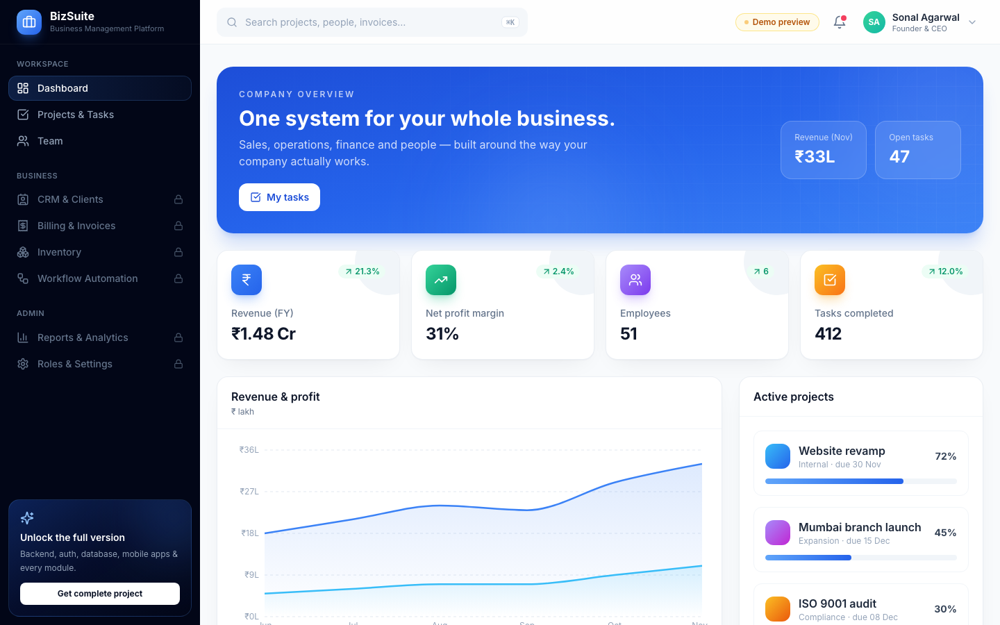
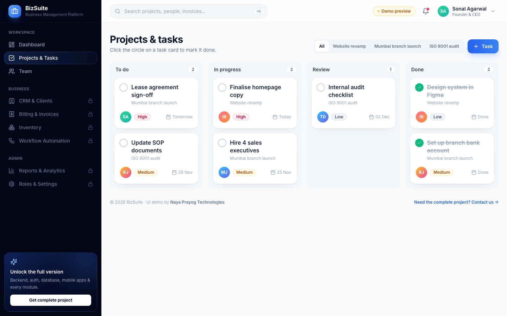
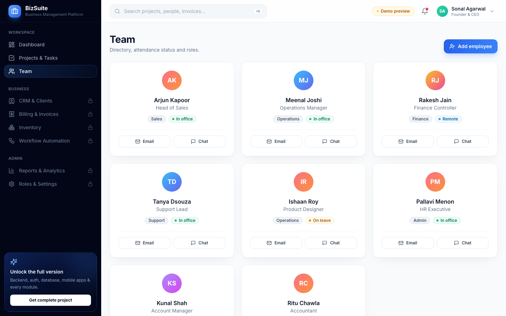

# Custom Business Management Software Development

**Custom Business Management Software for businesses that want to simplify operations, automate workflows, improve productivity, and manage their entire organization through one centralized platform.**

Naya Prayog Technologies develops customized business management software for startups, small businesses, growing companies, and established organizations. We build software around your business processes instead of forcing your organization to work around generic tools.

Whether you need an integrated business management system, custom ERP software, CRM, inventory management, billing, employee management, or workflow automation, we can help you plan and develop a solution aligned with your operational requirements.

**Website:** https://nayaprayog.com/

---

## What Is Custom Business Management Software?

Custom Business Management Software is a centralized digital solution designed to manage and coordinate different business operations from one platform.

Instead of maintaining separate spreadsheets, disconnected applications, and manual records, businesses can use customized software to organize information, manage teams, monitor performance, and automate repetitive tasks.

Naya Prayog Technologies develops business management solutions based on your organization's structure, industry, workflows, and future growth requirements.

## Business Management Software Development Services

We can develop customized modules according to your business needs.

### 1. Business Administration and Dashboard
- Centralized business dashboard
- Business performance overview
- Department-wise management
- Role-based user access
- Activity tracking
- Reports and analytics
- Configurable business settings

### 2. Customer Relationship Management (CRM)
- Customer database management
- Lead and enquiry management
- Sales pipeline tracking
- Follow-up scheduling
- Customer communication history
- Sales performance reports

### 3. Employee and HR Management
- Employee records
- Department and designation management
- Attendance management
- Leave management
- Task assignment
- Employee performance tracking
- Payroll-related workflows, where required

### 4. Inventory and Product Management
- Product and service management
- Stock tracking
- Purchase management
- Supplier management
- Stock movement records
- Low-stock notifications
- Inventory reporting

### 5. Sales, Billing and Financial Operations
- Sales order management
- Invoice generation
- Billing management
- Payment tracking
- Expense management
- Financial summaries
- Tax and GST-related workflows, where applicable

### 6. Project and Task Management
- Project creation and tracking
- Task assignment
- Team collaboration
- Deadlines and milestones
- Work progress monitoring
- Project reports

### 7. Workflow and Business Process Automation
- Automated task workflows
- Approval processes
- Notifications and reminders
- Document management
- Repetitive process automation
- Department-level workflow coordination

### 8. Reports and Business Analytics
- Custom business reports
- Sales and revenue analysis
- Employee productivity reports
- Inventory analysis
- Operational performance tracking
- Data visualization dashboards

*These are potential modules and capabilities. The final features, integrations, and implementation depend on the agreed project scope.*

## Who Needs Custom Business Management Software?

Our solutions can be designed for:

- Small and medium-sized businesses
- Startups and growing companies
- Retail and wholesale businesses
- Manufacturing companies
- Distributors and suppliers
- Service-based businesses
- Educational organizations
- Healthcare organizations
- Restaurants and hospitality businesses
- Multi-branch organizations
- Enterprises with specialized workflows

## Why Choose Custom Business Management Software?

### Built Around Your Business
Get software designed around your actual business operations, policies, and workflows.

### Centralized Business Operations
Bring different departments and operational activities together in one system.

### Reduce Manual Work
Automate repetitive processes and reduce dependency on spreadsheets and manual records.

### Better Business Visibility
Use centralized dashboards and reports to understand business performance.

### Flexible and Scalable
Start with the modules you need and expand the system as your business grows.

### Role-Based Access
Organize access according to employee responsibilities and organizational hierarchy.

## Custom Software Development by Naya Prayog Technologies

Naya Prayog Technologies provides custom software development and business automation services for organizations in India and internationally.

Our development capabilities include:

- Custom business management software
- ERP software development
- CRM development
- Web application development
- Android and iOS application development
- Flutter application development
- Database design and management
- API development and third-party integrations
- AI-powered business automation
- Reporting and business intelligence solutions
- Cloud deployment and software maintenance

We can develop web-based systems, mobile applications, and integrated business platforms depending on your requirements.

## Our Development Approach

1. **Business Requirement Analysis:** Understand your business model, processes, challenges, and objectives.
2. **System Planning:** Define modules, user roles, workflows, database structure, and integrations.
3. **UI/UX Design:** Plan an intuitive interface for administrators, employees, and other users.
4. **Software Development:** Develop the required modules and business logic.
5. **Testing and Quality Assurance:** Validate functionality, workflows, and application performance.
6. **Deployment:** Deploy the approved application to the agreed hosting or cloud environment.
7. **Maintenance and Enhancements:** Support future improvements according to the project agreement.

## Frequently Asked Questions

### What is the difference between business management software and ERP software?

Business management software is a broad category covering applications that manage business operations. ERP software generally integrates multiple core business functions into a coordinated system. A custom solution can include ERP-style modules depending on your requirements.

### Can you develop software specifically for my business?

Yes. We can analyze your business requirements and develop a customized solution around your workflows, departments, users, and operational needs.

### Can I manage multiple departments through one system?

Yes. A centralized platform can be designed to support multiple departments, user roles, and interconnected workflows.

### Can you develop both web and mobile applications?

Yes. Depending on the project requirements, the solution can include a web-based administration panel and Android or iOS applications.

### Can I integrate existing software or third-party services?

API integrations and connections with supported third-party services can be included in the agreed project scope.

### How much does custom business management software cost?

The cost depends on the number of modules, complexity, integrations, platforms, security requirements, and development scope. Contact our team for a project-specific estimate.

## Build Your Custom Business Management System

Still managing your business through disconnected tools, spreadsheets, or manual processes?

Let's discuss how customized software can help streamline your operations, improve productivity, and support your business growth.

**Naya Prayog Technologies**

- Website: https://nayaprayog.com/
- Email: [support@nayaprayog.com](mailto:support@nayaprayog.com)
- Phone / WhatsApp: +91 7991327022
- WhatsApp Enquiry: https://wa.me/917991327022
- Portfolio: https://github.helloharendra.io

**Have a software requirement? Contact us to discuss your project.**

---

## Repository Information

This repository represents the custom business management software development services and solution capabilities of Naya Prayog Technologies.

It is intended as a project and service showcase. It does not grant permission to redistribute, commercially use, or reproduce proprietary source code, designs, or intellectual property.

For licensing or commercial enquiries, contact Naya Prayog Technologies.

<!-- screenshots -->
## Screenshots

**Dashboard**

<table>
  <tr>
    <td align="center" width="50%"><b>Projects</b>  </td>
    <td align="center" width="50%"><b>Team</b>  </td>
  </tr>
</table>
